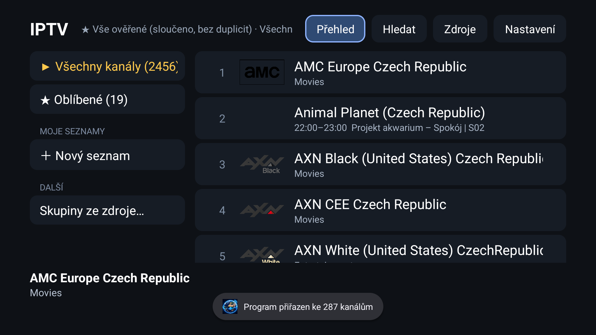
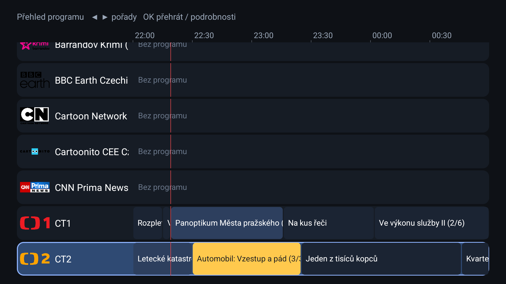

# IPTV pro Android TV

Jednoduchá appka pro sledování internetových TV kanálů na Android TV / Google TV. Je napsaná pro ovládání dálkovým ovladačem, má přehled programu (EPG), oblíbené kanály, vlastní seznamy a hotový seznam několika tisíc ověřených kanálů, hlavně českých a slovenských.

| Seznam kanálů | Přehled programu |
|---|---|
|  |  |

## Co umí

- **Ověřený seznam kanálů** (asi 2 450) sloučený z veřejných seznamů [iptv-org](https://github.com/iptv-org/iptv), [Free-TV](https://github.com/Free-TV/IPTV) a [TDT Channels](https://www.tdtchannels.com/), bez duplicit a bez nefunkčních streamů. U části kanálů jsou záložní adresy, které se zkusí samy.
- **Další zdroje:** cokoli ve formátu M3U lze přidat v appce (Zdroje).
- **Program (EPG)** u kanálů, přehled programu jako časová osa na 3 hodiny, popis pořadů.
- **Připomínky** na pořady (notifikace a okno v appce).
- **Oblíbené, vlastní seznamy, řazení a přejmenování kanálů, hledání.**
- **Přehrávač:** přepínání kanálů, zadání čísla kanálu, návrat na předchozí kanál, výběr zvuku, titulků a kvality, poměr stran.
- **Kontrola kanálů:** skryje ty, které už nefungují.
- **Záloha a obnova** oblíbených, seznamů a nastavení do souboru.

## Instalace

Potřebuješ Android TV nebo Google TV a počítač ve stejné síti.

1. Stáhni `app-release.apk` z [Releases](../../releases).
2. Na TV zapni Nastavení → O zařízení → ťukni 7× na „Sestavení“ → Možnosti pro vývojáře → Ladění USB (případně ladění přes síť).
3. Nainstaluj APK z počítače (nástroj `adb` z [Android platform-tools](https://developer.android.com/tools/releases/platform-tools)):
   ```
   adb connect IP_ADRESA_TV:5555
   adb install -r app-release.apk
   ```
   Případně APK zkopíruj na USB disk a otevři ho správcem souborů na TV.
4. Spusť appku „IPTV“. Po instalaci ladění na TV vypni.

## Ovládání

| Tlačítko | V seznamu | V přehrávači |
|---|---|---|
| OK | přehrát kanál | informace o pořadu, dlouze: možnosti |
| Šipka vpravo / Menu | nabídka kanálu | program kanálu (Menu: možnosti) |
| Nahoru / dolů | pohyb v seznamu | další / předchozí kanál |
| Šipka vlevo | menu vlevo | předchozí kanál |
| Číslice | | skok na kanál podle čísla |
| Dlouze nahoru | skok na horní lištu | |

## Program (EPG)

Appka si program stáhne ze seznamu kanálů nebo z adresy, kterou zadáš v Nastavení → Adresa programu (EPG). Výchozí zdroj je velký soubor (asi 96 MB). Rychlejší je malá verze zmenšená jen na kanály z tohoto seznamu. Tu si vytvoří GitHub Actions v tomto repozitáři (`.github/workflows/epg.yml`, skript `tools/epg_filter.py`) každých 6 hodin do `docs/epg.xml.gz`. Adresa:

```
https://raw.githubusercontent.com/SIMlordON/iptv-app/main/docs/epg.xml.gz
```

## Sestavení ze zdroje

Potřebuješ Android SDK a JDK 17.

```
./gradlew assembleRelease
```

Výsledek je v `app/build/outputs/apk/release/`. Release APK je podepsané ladicím klíčem, pro vlastní distribuci použij vlastní keystore.

## Upozornění

Appka sama žádný obsah nehostuje ani nenabízí. Zobrazuje odkazy na veřejně dostupné streamy ze seznamů třetích stran a jejich dostupnost, legalitu ani kvalitu nezaručuje. Některé kanály mohou být zablokované podle země. Za používání odpovídá uživatel. Seznamy a program pocházejí z projektů iptv-org, Free-TV, TDT Channels a IptvX a řídí se jejich podmínkami.

## Licence

[MIT](LICENSE)
